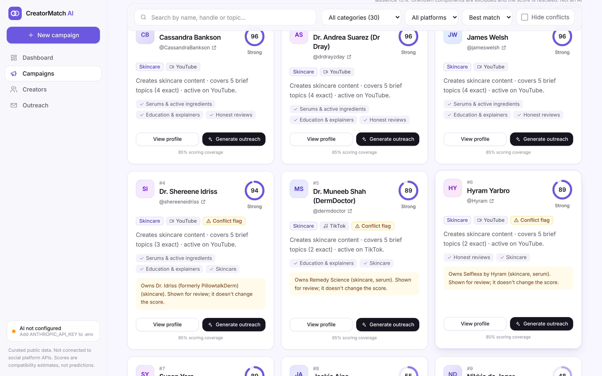
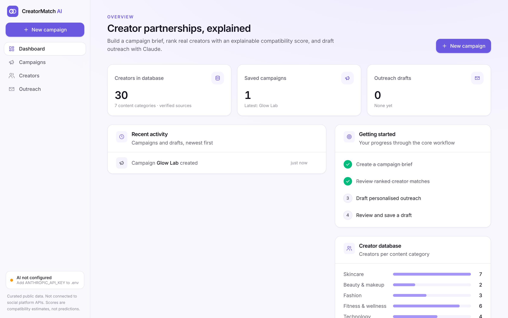
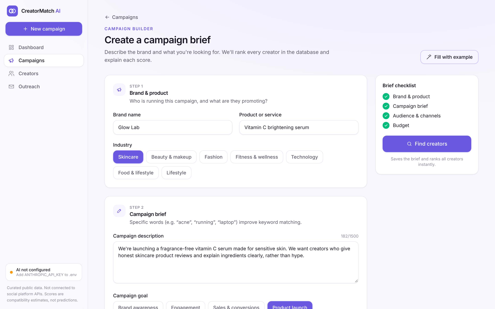
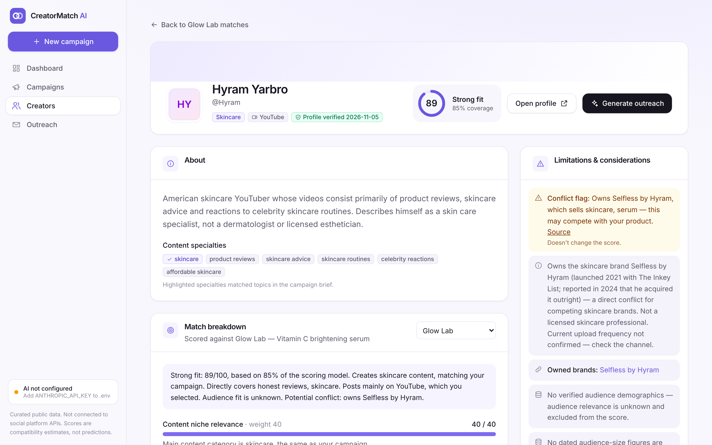

# CreatorMatch AI

**Creator discovery and AI-assisted outreach for brand partnerships.**

A brand writes a campaign brief. CreatorMatch AI ranks a curated database of real public creators with a **deterministic, explainable compatibility score**, shows exactly *why* each creator fits (and where they might not), and uses the **Anthropic Claude API** to draft a personalised outreach email that a person must review before it is used.

> [!IMPORTANT]
> **This is not an official creator marketplace or a live social-media analytics platform.**
> Creator information is a small, hand-curated snapshot of publicly available sources (verified 5 November 2026). The app is **not** connected to Instagram, TikTok or YouTube APIs, is **not** affiliated with or endorsed by any creator or platform, and does **not** provide real-time availability, partnership pricing, audience demographics or engagement data. Compatibility scores are algorithmic estimates, not predictions.



| Dashboard | Campaign builder | Creator details |
|---|---|---|
|  |  |  |

---

## Contents

1. [Features](#features)
2. [Tech stack](#tech-stack)
3. [Architecture](#architecture)
4. [How the matching algorithm works](#how-the-matching-algorithm-works)
5. [How the AI integration works](#how-the-ai-integration-works)
6. [Creator data and sources](#creator-data-and-sources)
7. [Getting started](#getting-started)
8. [Environment variables](#environment-variables)
9. [Testing](#testing)
10. [API reference](#api-reference)
11. [Security and privacy](#security-and-privacy)
12. [Known limitations](#known-limitations)
13. [What I learned](#what-i-learned)
14. [How AI coding assistance was used](#how-ai-coding-assistance-was-used)

---

## Features

| Screen | What it does |
|---|---|
| **Dashboard** | Real counts from the database: creators, saved campaigns, outreach drafts (reviewed vs. needing review), plus recent activity, workflow progress and creators per category. No invented analytics. |
| **Campaign builder** | A four-step brief (brand and product, brief and goal, audience and platforms, budget). Validated in the browser for instant feedback and again on the server with zod. Includes "Fill with example" for demos. |
| **Creator discovery** | Every creator ranked for the campaign, with score, tier, niche, platform and a one-line explanation. Search, category, platform, sort and "hide conflicts" filters. "How we read your brief" shows the weighted topics the algorithm found. |
| **Creators directory** | Browse all 30 researched creators without a campaign. |
| **Creator details** | Description, content specialties, clickable verified sources, dated audience data (where it exists), limitations and conflict flags, and the full score breakdown against any campaign. Optional plain-English summary from Claude. |
| **AI outreach studio** | Claude drafts a subject, body and personalisation explanation from **verified facts only**. Email-style editor, an "AI-generated draft — requires human review" label, **Copy locked until reviewed**, Save draft, and regenerate with limits. |
| **Outreach drafts** | Saved in SQLite with which model wrote them and whether they've been reviewed. Edit, filter and delete. |

The whole UI has loading skeletons, empty states, success toasts, specific error messages with retry, and a responsive layout (sidebar on desktop, drawer on mobile).

## Tech stack

| Layer | Technology | Why |
|---|---|---|
| Frontend | **React 19**, **TypeScript**, **Vite**, React Router | Component-based UI with type safety; fast dev server with an `/api` proxy |
| Styling | **Tailwind CSS v4** | Design tokens defined once in `client/src/index.css`, used consistently |
| Backend | **Node.js 22**, **Express 5**, **TypeScript** (run with `tsx`) | Simple REST API; Express 5 forwards async errors to one error handler |
| Database | **SQLite** via `better-sqlite3` | Zero-setup, file-based, synchronous API that's easy to read and test |
| Validation | **zod** | One schema per shape, shared by request validation, seed data and AI output |
| AI | **Anthropic Claude API** via the official `@anthropic-ai/sdk` | Called only from the backend; structured outputs for reliable JSON |
| Testing | **Vitest**, **Supertest**, **Playwright** | Unit, API and end-to-end browser tests |
| Tooling | npm workspaces, `concurrently`, Git | One command starts both apps |

## Architecture

```
┌────────────────────────┐   /api/*   ┌──────────────────────────────────┐   SQL   ┌───────────────┐
│ React app (Vite)       │ ─────────▶ │ Express API (TypeScript)         │ ──────▶ │ SQLite file   │
│ localhost:5173         │ ◀───────── │ localhost:3001                   │         │ creators      │
│ · no secrets           │    JSON    │ · zod validation                 │         │ campaigns     │
│ · Vite proxies /api    │            │ · matching algorithm (no AI)     │         │ outreach_     │
└────────────────────────┘            │ · rate limit · error handler     │         │   drafts      │
                                      └────────────────┬─────────────────┘         └───────────────┘
                                                       │ HTTPS (API key stays here)
                                                       ▼
                                              Anthropic Claude API
```

```
creatormatch-ai/
├── client/                    React + Vite frontend
│   └── src/
│       ├── api/client.ts      every fetch() in one place, typed errors
│       ├── components/        Layout (sidebar), CreatorCard, ScoreRing, Toast, UI kit, icons
│       └── pages/             Dashboard, Campaigns, Builder, Discovery, Creators, Details, Studio, Drafts
├── server/                    Express + SQLite backend
│   ├── src/
│   │   ├── data/creators.json curated creator seed data (committed)
│   │   ├── db/                schema, connection, seed and reset scripts
│   │   ├── middleware/        error handler, rate limiter
│   │   ├── repositories/      all SQL (parameterised queries)
│   │   ├── routes/            creators, campaigns, matches, outreach, drafts
│   │   ├── services/
│   │   │   ├── matching/      taxonomy.ts · text.ts · index.ts (the scoring algorithm)
│   │   │   ├── outreach.ts    Claude outreach: prompt, structured output, validation, retry
│   │   │   ├── matchExplainer.ts  Claude plain-English summaries with a number guardrail
│   │   │   └── ai.ts          SDK client, error mapping
│   │   └── validation/        zod schemas
│   ├── tests/                 Vitest + Supertest (offline, mocked AI)
│   └── tests-live/            optional tests against the real Claude API
├── e2e/                       Playwright end-to-end workflow test
├── scripts/                   secret-leak check
└── docs/                      algorithm, AI integration, dataset notes, demo script
```

Design choices:
- **Layered backend.** Routes handle HTTP, validation lives in zod schemas, repositories own the SQL, and services hold the business logic.
- **Dependency injection.** `createApp(db, { outreachGenerator, matchExplainer })` receives its database and AI clients as arguments, so tests run on an in-memory database with a fake Claude.

## How the matching algorithm works

The score is **deterministic**: plain rules with fixed weights, no AI and no randomness. The same campaign and creator always produce the same number, and every point is explained in the UI.

| Component | Weight | Value (0–1) |
|---|---|---|
| Content niche relevance | 40 | Same category 1 · related category (e.g. skincare ↔ beauty) 0.4 · otherwise 0 |
| Campaign keyword relevance | 25 | Weighted share of the brief's topics the creator covers |
| Platform compatibility | 20 | Creator's primary platform is selected 1 · otherwise 0 |
| Verified audience relevance | 15 | Age-range overlap, **only** from sourced data; otherwise *unknown* |

**Related words match.** A hand-written topic taxonomy groups words into topics, and topics into families. For example, *serum*, *moisturizer* and *acne* are all in the skincare family. A match on the exact topic gets full credit; a match on a related topic in the same family gets half credit. Text is matched longest phrase first, so "home workouts" isn't also read as "home", and "fragrance-free" never matches "fragrance".

**Keywords aren't equal.** A topic's importance = where it appears (product name 1.5×, description 1×, target audience 0.5×) × how specific it is (specific 1×, broad 0.5×).

**Missing data isn't guessed.** No creator has verified audience demographics, so that component is marked *unknown* and left out, and the score is rescaled over what *was* measured:

```
score    = 100 × (points earned from measured components) ÷ (weights of measured components)
coverage = weights of measured components        → 85% when audience data is unknown
```

**Conflicts are flags, not penalties.** If a creator owns a brand selling what the brief describes (from a cited source), they get a visible conflict flag, but the score doesn't change.

Worked example: a skincare creator on a selected platform covering most of the brief's topics scores `40 + 21.9 + 20 = 81.9` out of `85` measurable points, so `81.9 ÷ 85 × 100 = 96`, with 85% coverage.

📄 Full walkthrough with talking points: **[docs/MATCHING_ALGORITHM.md](docs/MATCHING_ALGORITHM.md)**

## How the AI integration works

Claude is used for **language only**: writing outreach drafts and, optionally, rephrasing an already-calculated score in plain English. It never decides a score.

1. The browser sends only `{ campaignId, creatorId }` to `POST /api/outreach/generate`. It never sees the API key.
2. The server builds a prompt from the campaign brief and the creator's **verified** profile fields. Internal notes, owned brands, audience figures and the exact budget are never sent.
3. It calls Claude with the official SDK. The model comes from `ANTHROPIC_MODEL`, and **structured outputs** use a JSON Schema generated from a zod schema.
4. The reply is checked:
   - **stop reason** (refusal or cut-off)
   - **JSON parse**
   - **zod schema** (subject, body, personalisation note, with length limits)
   - **guardrails**: rejects any email address, phone number, URL, follower or engagement figure, payment amount, claim of prior contact, or claimed past partnership
5. If a check fails, the server retries **once** automatically. The user can then retry up to 3 times, or write the email themselves. The API is limited to 10 AI requests per minute per user.
6. The draft is labelled **"AI-generated draft — requires human review"**. Copy unlocks only after the user ticks "I've reviewed this email". Nothing is ever sent automatically.

For score summaries, code rejects any Claude sentence containing a number that isn't in the calculated results.

📄 Full details: **[docs/AI_OUTREACH.md](docs/AI_OUTREACH.md)**

## Creator data and sources

- **30 real, public creators** across skincare, beauty, fashion, fitness, technology, food and lifestyle, in [`server/src/data/creators.json`](server/src/data/creators.json). This file is committed, so anyone can initialise the database.
- Researched on **5 November 2026** using web search. Every creator has a confirmed profile URL, 1–3 public source links (Wikipedia, trade press, the creator's own channel), a verification date and a verification note.
- **Audience figures** are included only where a source gives both the number *and* the date (3 creators). Everyone else shows "Not available".
- **Never stored:** contact details, sponsorship rates, engagement rates, demographic percentages or availability. The data validator rejects unknown fields.
- **Conflicts** (brands a creator owns, public controversies) are listed only when a cited source supports them.
- Creator names and handles belong to the creators. They appear here only as publicly available information, for a non-commercial portfolio demonstration.

📄 Per-creator research table and items still needing a manual check: **[docs/CREATOR_DATASET.md](docs/CREATOR_DATASET.md)**

## Getting started

### Prerequisites
- **Node.js 22 or newer** (required by `better-sqlite3` and Vite). Check with `node -v`. If you use nvm, run `nvm use`; the repo includes `.nvmrc`.
- npm 10+ and Git
- *Optional:* an [Anthropic API key](https://console.anthropic.com) for AI features. Everything else works without one.

### Setup

```bash
git clone https://github.com/<your-username>/creatormatch-ai.git
cd creatormatch-ai
npm install                 # installs both client and server (npm workspaces)
cp .env.example .env        # then optionally add your ANTHROPIC_API_KEY
npm run db:reset            # creates the SQLite database and seeds the 30 creators
npm run dev                 # API on :3001, web app on http://localhost:5173
```

Open **http://localhost:5173** and click **New campaign → Fill with example → Find creators**.

To check the AI connection (one real API call, a fraction of a cent):

```bash
npm run ai:check
```

### Scripts

| Command | What it does |
|---|---|
| `npm run dev` | Start API and web app together |
| `npm test` | All offline tests: backend and frontend |
| `npm run typecheck` | Type-check server and client |
| `npm run build` | Production build of the frontend |
| `npm run db:reset` | Delete the database, recreate tables, seed creators (stop `npm run dev` first) |
| `npm run db:seed` | Reload `creators.json` into the existing database, keeping campaigns and drafts |
| `npm run ai:check` | One real Claude call to verify your key and model |
| `npm run test:live` | Live integration tests against Claude (3 small requests; skipped without a key) |
| `npm run test:e2e` | Browser workflow test against the running app (needs Playwright, see below) |
| `npm run check:secrets` | Builds the frontend with a fake key set and verifies it appears nowhere in the bundle |

## Environment variables

Copy `.env.example` to `.env` in the project root. `.env` is git-ignored. **All variables are read only by the backend**; none reach the browser.

| Variable | Required | Default | Purpose |
|---|---|---|---|
| `ANTHROPIC_API_KEY` | Only for AI features | *(empty)* | Your Claude API key (`sk-ant-…`). Without it, the app runs normally and AI buttons show setup instructions. |
| `ANTHROPIC_MODEL` | No | `claude-opus-5-5` | Claude model for outreach and summaries |
| `PORT` | No | `3001` | API port. The web app's dev proxy follows it automatically. |
| `DATABASE_PATH` | No | `./data/creatormatch.db` | SQLite file, relative to `server/` |

Restart `npm run dev` after editing `.env`. The sidebar shows **Claude connected** when a key is loaded.

## Testing

```bash
npm test                 # 172 offline tests (157 backend + 15 frontend)
npm run typecheck
npm run check:secrets
```

**Offline tests never call the paid API.** They inject a fake Claude client.

| Area | Tests | Highlights |
|---|---|---|
| Matching algorithm | 36 | The same input always gives the same score; changing platform or category changes rankings; missing demographics stay `null`; related terms match; keyword weighting; conflicts don't change scores; real-dataset scenarios (skincare, apparel, tech, food, fashion) |
| AI outreach and summaries | 46 | Zod validation, every guardrail, prompt contents, retry rules (malformed → retry → success, give up after 2, refusals not retried), SDK error mapping, rate limiting, number-checking for summaries |
| Creator data | 19 | Dataset validation, profile URLs match handle and platform, https sources only, no pricing or demographic data, missing info stays `null`, re-seeding keeps drafts |
| API and errors | 50 | Every endpoint, 400/404/413/503 handling, invalid ids, campaign validation, drafts CRUD |
| Security | 6 | Frontend never imports the SDK or reads env vars; Vite loads only `PORT`; `.env` is ignored |
| Frontend | 15 | API client error handling, form validation, display helpers |

**End-to-end** (30 browser checks covering the whole workflow, plus mobile layouts at 390px):

```bash
npm i -D playwright && npx playwright install chromium   # one-time
npm run dev                                              # terminal 1
npm run test:e2e                                         # terminal 2
```

**Live AI** (makes real calls; needs a key in `.env`): `npm run test:live`.

## API reference

| Method | Path | Purpose |
|---|---|---|
| GET | `/api/health` | Status, and whether AI is configured |
| GET | `/api/creators?search=&niche=&platform=` | List and filter creators |
| GET | `/api/creators/:id` | One creator |
| GET / POST | `/api/campaigns` | List / create campaigns |
| GET | `/api/campaigns/:id` | One campaign |
| GET | `/api/campaigns/:id/matches` | All creators ranked, plus the brief's weighted topics |
| GET | `/api/campaigns/:id/matches/:creatorId` | One creator's score breakdown |
| POST | `/api/campaigns/:id/matches/:creatorId/explanation` | Claude's plain-English summary of the calculated result |
| POST | `/api/outreach/generate` | `{ campaignId, creatorId }` → AI draft (not saved) |
| GET / POST | `/api/drafts` | List (`?campaignId=`) / save drafts |
| GET / PUT / DELETE | `/api/drafts/:id` | Read / edit or mark reviewed / delete |

Errors always look like `{ "error": "message", "details": [...] }`. AI errors also include `code` and `retryable`.

## Security and privacy

- The Anthropic key lives only in the server's `.env`. Automated tests and `npm run check:secrets` verify it can't reach the frontend.
- All SQL uses parameterised queries, and every request body and query string is validated with zod.
- Errors from the AI service are mapped to safe messages, so raw provider errors never reach the browser.
- The API limits AI requests (10 per minute per client) to protect your bill.
- There's no email-sending code. Drafts must be reviewed and copied by a person.

## Known limitations

- **Static data:** a curated snapshot, not live. Handles can change, so check profile links before outreach. Some items still need a manual check (see [docs/CREATOR_DATASET.md](docs/CREATOR_DATASET.md)).
- **No audience demographics**, so every score has 85% coverage. Audience size is never used as a proxy for cost.
- **Hand-written taxonomy:** words it doesn't know aren't matched. Only each creator's *primary* platform counts. The partial-credit values (0.4, 0.5) are design choices, not learned.
- **Pattern-based AI guardrails** can miss subtle wrong claims, which is why human review is required.
- **Local, single-user prototype:** no authentication, and the rate limiter is in memory.
- Re-seeding removes drafts for any creator taken out of the dataset.

